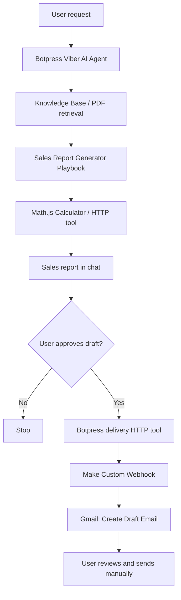
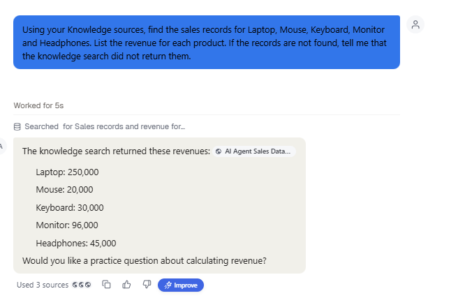
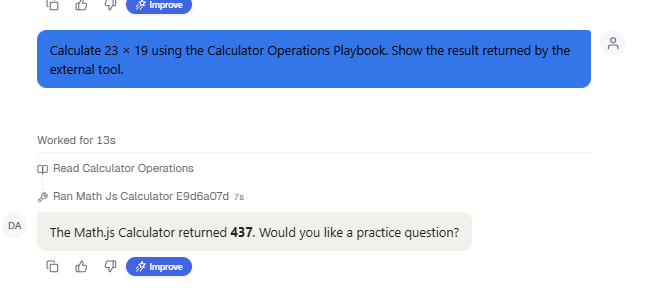
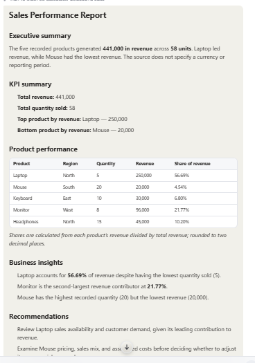
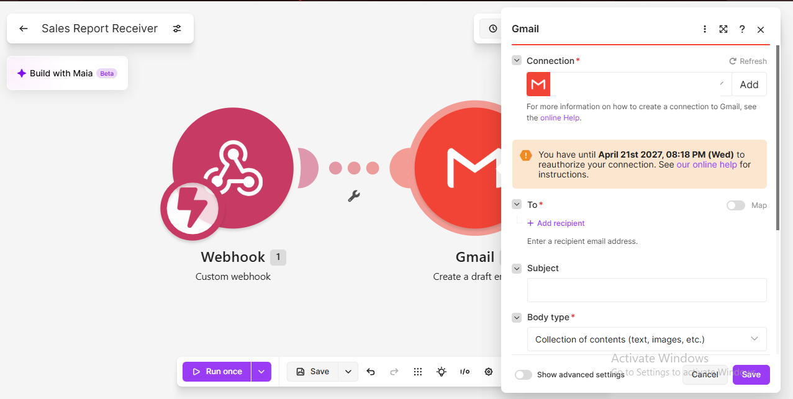
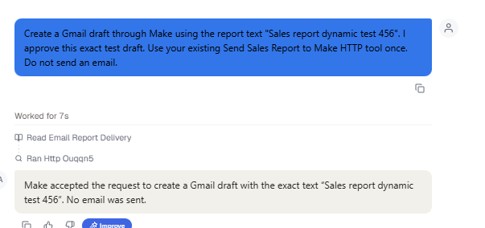

# No-Code AI Sales Reporting Agent

A no-code AI-powered sales reporting workflow built with **Botpress Viber**, **retrieval-augmented generation (RAG)**, **Math.js**, **Make.com**, and **Gmail Drafts**.

The agent retrieves fictional product sales data from a PDF knowledge source, uses an external calculator tool for numerical analysis, generates a structured business report, and—after explicit approval—passes report text through a Make webhook to create a Gmail **draft** for review. It does **not** automatically send emails.

> **Portfolio demonstration:** This repository documents a live no-code workflow. It does not contain the hosted Botpress agent, your connected Gmail account, or live service credentials.

## Architecture

## Features

- Question answering about SQL, Power BI, and analytics fundamentals
- Retrieval of sales records from a Botpress Knowledge Base
- External mathematical calculations via the Math.js API
- KPI reporting: revenue, units sold, top/bottom products, and revenue shares
- Playbook-driven report formatting and business insights
- Approval-controlled delivery through a Make webhook
- Gmail **draft creation** with dynamic report-body mapping (no automatic sends)

## Demonstration dataset

The fictional dataset is included in [`data/sales_data.csv`](data/sales_data.csv).

| Metric | Result |
| --- | ---: |
| Total revenue | ₹441,000 |
| Units sold | 58 |
| Highest-revenue product | Laptop (₹250,000) |
| Laptop revenue share | 56.69% |
| Lowest-revenue product | Mouse (₹20,000) |

These results refer to the sample dataset, not live sales performance.

## Technology stack

| Component | Purpose |
| --- | --- |
| Botpress Viber | Agent configuration, knowledge, Playbooks, and tools |
| Botpress Knowledge | Retrieval of sample sales records from an uploaded PDF |
| Math.js API | External arithmetic through an HTTP Request tool |
| Make.com | Receives an approved report through a custom webhook |
| Gmail | Creates a draft email for human review |
| GitHub | Portfolio documentation and shareable safe project artifacts |

## How it works

1. The user requests a sales report in Botpress.
2. The agent retrieves the fictional sales figures from its Knowledge Base.
3. The Sales Report Generator Playbook calls the calculator for KPIs.
4. The agent presents a formatted report in the conversation.
5. After explicit user approval, the delivery Playbook invokes an HTTP POST tool.
6. Make receives the `report` field and maps it into **Gmail → Create a Draft Email**.
7. The user reviews the draft before optionally sending it manually.

## Screenshots and demonstration

Real, redacted build screenshots are included in [`screenshots/`](screenshots/):

**1. PDF knowledge retrieval — Botpress searches the uploaded sales source**

**2. External tool execution — Calculator Operations and Math.js**

**3. Generated sales report — KPIs, product table, business insights**

**4. Make scenario — webhook connected to Gmail draft creation**

**5. Delivery integration — Botpress invokes the HTTP tool**

A verified, properly redacted screenshot of the **final** Gmail draft can be added later. It is not included because the earlier captured draft screenshot showed a mapping issue that was subsequently fixed.

See [`docs/demo.md`](docs/demo.md) for a suggested demonstration script and [`screenshots/README.md`](screenshots/README.md) for screenshot notes.

## Reproducing the workflow

See [`docs/setup.md`](docs/setup.md). You need your own Botpress workspace, Make scenario, and Gmail connection. The external services and usage limits are independent of this repository.

## Security and limitations

- **Never commit** webhook URLs, API keys, authentication headers, account connection details, or unredacted account screenshots.
- Rotate any webhook URL already displayed publicly or shared elsewhere before reusing the scenario.
- Make scenario blueprints may contain configured URLs or mapped values; sanitize exports before committing them.
- No live Google Sheets connection is included; the sales source is a manually uploaded PDF.
- Numerical results should always be verified. This example uses a small fictional dataset.
- Email sending is **not** automated. The workflow creates drafts for review.

See [`docs/security.md`](docs/security.md) for the pre-publication checklist.

## Future improvements

- Replace static PDF input with authorized, read-only live data access
- Add validation and error handling for malformed or incomplete records
- Include report date metadata and automated data-quality checks
- Introduce authenticated webhook requests and safer secret management
- Add monitoring and tests for tool failures and unexpected report content

## Project type

**No-code / low-code AI agent portfolio project.** Built as a practical learning project using fictional data.
